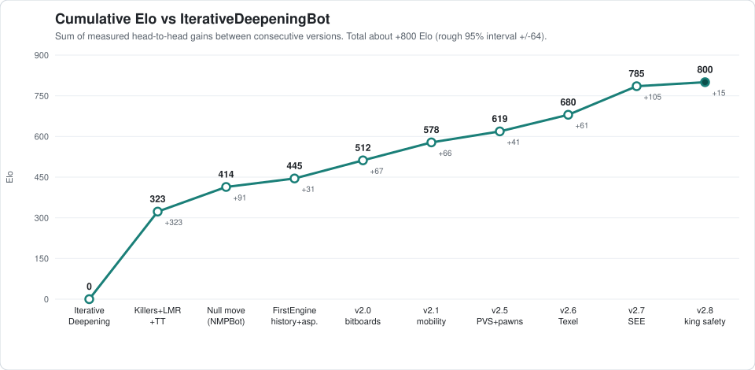

# TurquoiseBOT

A chess engine written from scratch in Java: bitboard move generation, an alpha-beta search with the usual modern pruning and ordering techniques, a Texel-tuned evaluation, and a self-play testing harness that decides every change with confidence intervals and a sequential probability ratio test (SPRT).

When the bot is online, it can be challenged in blitz and rapid time controls on Lichess at: https://lichess.org/@/TurquoiseBOT.

**Author:** Rahul Rani   
**Language:** Java (compiles with `--release 8`)   
**Search:** single-threaded  
**Strength:** about +800 Elo over the first version in self-play (a rough chained estimate, see [Results](#results))




## Contents
1. [Engine at a glance](#engine-at-a-glance)
2. [Versions and naming](#versions-and-naming)
3. [Getting started](#getting-started)
4. [Testing methodology](#testing-methodology)
5. [Results](#results)
6. [Version details](#version-details)
7. [Testing history and selection effects (v2.8)](#testing-history-and-selection-effects-v28)
8. [Known limitations](#known-limitations)
9. [Glossary and references](#glossary-and-references)
10. [License](#license)

---

## Engine at a glance

| Area | What is implemented |
|---|---|
| Board and move generation | Bitboard board representation, precomputed attack tables, legal move generation, incremental Zobrist hashing, threefold-repetition and fifty-move detection |
| Search | Iterative deepening, alpha-beta, principal variation search (PVS), transposition table, null-move pruning, late move reductions (LMR), aspiration windows, static-exchange evaluation (SEE) |
| Move ordering | Hash move, killer moves, history heuristic, counter-move heuristic, SEE |
| Evaluation | Tapered (midgame/endgame) piece-square tables including a separate king endgame table, tapered mobility, isolated pawns, passed pawns with king-proximity scaling, king safety (pawn shield, open files, king-zone attackers, attacker-material scaling). Constants are Texel-tuned |
| Testing and tooling | `PerftTest`, `EvalSymmetryTest`, `KingSafetyTest`, `SpeedBench`, `SuiteRunner` (self-play A/B harness), `TexelTuner` (parameter tuner), a Swing GUI (`App`) |

## Versions and naming

The project is one development line (TurquoiseBot). Each benchmarked milestone is frozen as its own class and then named after its headline feature, so it can be used as a fixed opponent. Versions from 2.0 onward carry a version number (`getVersion()` in code). `TurquoiseBot.java` is always the most advanced engine: currently an exact copy of KingSafetyBot (v2.8), and the file where the next version is developed. Besides it, the source tree keeps only the latest frozen version (KingSafetyBot) and its baseline (SEEBot) as classes. Every earlier milestone is a git tag, so a fixed opponent can be rebuilt with `git checkout <tag>`.

| Version | Class | Date | Headline change |
|---|---|---|---|
| (none) | IterativeDeepeningBot | 2026-04-16 | Iterative deepening + alpha-beta |
| (none) | KillersAndLMRBot | 2026-04-18 | Transposition table, killers, LMR, tapered PST |
| (none) | NMPBot | 2026-04-28 | Null-move pruning, en passant and mate-score fixes |
| (none) | FirstEngine | 2026-05-08 | History/counter-move heuristics, aspiration windows |
| 2.0 | SecondEngine | 2026-06-21 | Bitboard rewrite |
| 2.1 | MobilityBot | 2026-06-23 | Tapered mobility bonuses |
| 2.5 | PVSBot | 2026-07-28 | PVS, isolated and passed pawns |
| 2.6 | TexelBot | 2026-07-29 | Texel-tuned evaluation constants |
| 2.7 | SEEBot | 2026-08-01 | Static-exchange evaluation |
| 2.8 | KingSafetyBot | 2026-10-24 | King-safety evaluation |

The array-based engines before 2.0 were removed from the source tree and are available in git history.

**Git tags:** `v2.1-mobilitybot`, `v2.5-pvsbot`, `v2.6-texelbot`, `v2.7-seebot`, `v2.8-kingsafetybot`. The v2.6 and v2.7 tags share a commit, in which `TexelBot.java` and `SEEBot.java` sit side by side. The tags also preserve the move generator exactly as it was when the results below were recorded (see [Known limitations](#known-limitations)).

## Getting started

Requires a JDK (8 or newer). From the repository root:

```bash
# compile (the attack tables are loaded from the classpath, so copy the .bin next to the classes)
javac --release 8 -d bin src/*.java
cp src/precomputed_attacks.bin bin/        # Windows: copy src\precomputed_attacks.bin bin\

# correctness tests (each exits non-zero on failure; PerftTest checks 35 reference node counts)
java -cp bin PerftTest                      # perft counts + hash/make-unmake integrity sweep
java -cp bin EvalSymmetryTest               # eval(position) == eval(colour-flipped position)
java -cp bin KingSafetyTest                 # king-safety unit tests

# speed benchmark: nodes/sec at a fixed think time on 20 fixed positions
java -cp bin SpeedBench 1000 3 SEEBot KingSafetyBot

# self-play A/B match: engine A defaults to SEEBot (-Dsuite.engineA=<Class>), engine B to KingSafetyBot (-Dsuite.engineB=<Class>)
java -cp bin -Dsuite.pairs=500 -Dsuite.moveTimeMs=3500 SuiteRunner
# writes suite_results.csv (one row per game) and suite_log.csv (one row per move) to the working directory

# Texel tuner -- needs a dataset of "FEN result" lines (default positions.txt, not included); options are documented in TexelTuner.java
java -cp bin TexelTuner --data positions.txt --ks-only --params-out tuned.txt

# GUI (run from the repository root: it loads lib/pieces.png)
java -cp bin App
```

**Playing on Lichess.** The engine speaks UCI through a front end that runs under [lichess-bot](https://github.com/lichess-bot-devs/lichess-bot). The UCI front end and the lichess-bot configuration, which hold an API token, are local only and not part of this repository.

## Testing methodology

Every strength claim below comes from `SuiteRunner`, a self-play harness in which engine B (the candidate) plays engine A (the baseline) in-process.

**Games and openings**
- 200 random quiet openings, 8 plies each (no captures or promotions), deduplicated by position hash, generated from a fixed seed (`20260726`) so every run uses the same book.
- Each opening is played as a color-reversed pair -- one game with A as White, one with A as Black. A match of 500 pairs is 1000 games.
- 500 pairs cycle through 200 openings, so 100 openings are used 3 times and 100 are used twice. Repeated openings are not fully independent samples (see limitations).
- Games run one at a time. Fresh engine instances (so empty transposition tables) are created for every game.

**Time control**
- Fixed time per move. `MOVE_TIME_MS` is passed to the engine as the time left, and the engine thinks for about `MOVE_TIME_MS / 40 - 10` ms. The default `MOVE_TIME_MS = 3500` is about 80 ms per move (measured ~79 ms). `MOVE_TIME_MS = 860` is about 12 ms per move.
- Game ends: checkmate, stalemate, threefold repetition, fifty-move rule. A 400 half-move limit and a 4-minute wall-clock limit both score as draws. An illegal move loses on the spot. There is no adjudication.

**Statistics**
- Score = (W + D/2) / N. Elo = 400 · log10(score / (1 − score)).
- 95% confidence interval on Elo: from the variance of the per-pair scores (0 to 2) for v2.5 onward. Earlier results have no pair structure (see below), so they use the per-game trinomial variance.
- LOS (likelihood of superiority) = Φ((W − L) / √(W + L)), which ignores draws.
- SPRT: pentanomial GSPRT on pair scores, H0: Elo ≤ 0 vs H1: Elo ≥ 10, α = β = 0.05, so the LLR bounds are ±2.944. The harness plays the full sample (`SPRT_STOP_EARLY = false`) so the Elo estimate is precise. In that mode the final LLR is the number to quote, and a first-crossing verdict is optimistic because the bounds are checked after every pair.

**Hardware.** Intel Core Ultra 7 256V laptop.

**Two harness generations.** The opening book and colour-reversed pairs were added to `SuiteRunner` on 2026-07-27. Before that, every game started from the standard starting position and results were a plain win/loss tally. Results for every version up to and including v2.1 come from that older harness. They are labelled "legacy" below. Games from a single start position are close to duplicates of each other, so the legacy intervals are likely too narrow and the legacy Elo numbers are best read as direction and rough size, not precise values. The time control used in the legacy runs was not recorded.

## Results

All entries compare a version (B) against the previous baseline (A). "Pairs" means the opening-book harness; "legacy" means the older single-start-position harness.

| B vs A | Harness | W / L / D | Games | Score | Elo (95% CI) | LOS | SPRT |
|---|---|---|---|---|---|---|---|
| KillersAndLMRBot vs IterativeDeepeningBot | legacy | 256 / 18 / 52 | 326 | 86.5% (282/326) | +322.7 ± 45.4 | 100.0% | n/a |
| NMPBot vs KillersAndLMRBot | legacy | 534 / 278 / 188 | 1000 | 62.8% | +91.0 ± 19.9 | 100.0% | n/a |
| FirstEngine vs KillersAndLMRBot | legacy | 564 / 238 / 198 | 1000 | 66.3% | +117.6 ± 20.1 | 100.0% | n/a |
| FirstEngine vs NMPBot | legacy | 440 / 350 / 210 | 1000 | 54.5% | +31.4 ± 19.2 | 99.9% | n/a |
| SecondEngine (v2.0) vs FirstEngine | legacy | 391 / 201 / 408 | 1000 | 59.5% | +66.8 ± 16.7 | 100.0% | n/a |
| MobilityBot (v2.1) vs SecondEngine (v2.0) | legacy | 276 / 88 / 636 | 1000 | 59.4% | +66.1 ± 12.8 | 100.0% | n/a |
| PVSBot (v2.5) vs MobilityBot (v2.1) | pairs | 312 / 195 / 493 | 1000 | 55.9% (558.5/1000) | +40.8 ± 14.5 | 100.0% | LLR +6.61, H1 accepted |
| TexelBot (v2.6) vs PVSBot (v2.5) | pairs | 347 / 173 / 480 | 1000 | 58.7% (587/1000) | +61.1 ± 14.5 | 100.0% | LLR +10.72, H1 accepted |
| SEEBot (v2.7) vs TexelBot (v2.6) | pairs | 436 / 142 / 422 | 1000 | 64.7% (647/1000) | +105.3 ± 15.4 | 100.0% | LLR not recorded |
| KingSafetyBot (v2.8) vs SEEBot (v2.7), 80 ms/move | pairs | 259 / 216 / 525 | 1000 | 52.15% (521.5/1000) | +14.9 ± 13.5 | 97.6% | LLR +2.12, inconclusive |
| KingSafetyBot (v2.8) vs SEEBot (v2.7), 12 ms/move | pairs | 297 / 231 / 472 | 1000 | 53.3% (533/1000) | +23.0 ± 14.3 | 99.8% | LLR +3.41, H1 bound crossed |

**Cumulative gain.** Chaining the consecutive gains (Killers+LMR, NMP, FirstEngine over NMP, 2.0, 2.1, 2.5, 2.6, 2.7, 2.8 at 80 ms/move) gives about **+800 Elo ± 64** over IterativeDeepeningBot. The interval adds the individual intervals in quadrature. It assumes Elo is additive across matches and mixes the two harness generations, so it is a rough picture and not a rating. As a consistency check, FirstEngine measured directly against KillersAndLMRBot is +117.6, while chaining NMP (+91.0) and FirstEngine over NMP (+31.4) gives +122.4. The two agree well inside the intervals. `docs/make_elo_chart.py` regenerates the chart.

## Version details

### IterativeDeepeningBot (2026-04-16)
- Iterative deepening
- Alpha-beta pruning

### KillersAndLMRBot (2026-04-18)
- King endgame piece-square tables
- Tapered evaluation for piece-square tables
- Transposition tables
- Killer-move tracking
- Late move reductions (LMR)

### NMPBot (2026-04-28)
- Null-move pruning
- Fixed en passant move generation
- Fixed mate-score handling

### FirstEngine (2026-05-08)
- History heuristic
- Counter-move heuristic
- Aspiration windows
- Improved move ordering

### SecondEngine, v2.0 (2026-06-21): switch to bitboards
- Bitboard representation of the game, to be faster
- Tweaked move-ordering weightings
- Refactored the iterative-deepening loop
- Same search and evaluation features as FirstEngine. Only the representation changed.

Earlier versions of this README listed depth, node-count and speed tables for this change. Those numbers contained a bug and have been withdrawn. The head-to-head result in the table above is not affected.

### MobilityBot, v2.1 (2026-06-23)
- Mobility bonuses for bishop, rook, knight and queen
- Tapered mobility bonuses

### PVSBot, v2.5 (2026-07-28)
- Isolated-pawn penalty
- Passed-pawn evaluation (replaces the doubled-pawn penalty), with king-proximity scaling
- Principal variation search (PVS)

### TexelBot, v2.6 (2026-07-29)
- Texel-tuned evaluation constants

### SEEBot, v2.7 (2026-08-01)
- Static-exchange evaluation

### KingSafetyBot, v2.8 (2026-10-24)
- King-safety evaluation. Search, move generation and all other evaluation terms are unchanged from SEEBot v2.7.
  - Pawn shield: holes and pushed shield pawns in front of a castled (wing) king
  - Open and half-open files next to the king
  - King-zone attackers: every knight, bishop, rook or queen attacking the king zone is counted once, weighted, and fed through a nonlinear (quadratic, capped) danger table. It needs at least 2 attackers and counts much less without a queen.
  - The whole penalty scales with the opponent's remaining attacking material, so it is 0 in pawn endgames.
  - Pawn-storm term (Texel-tuned to 0, kept for future tuning)
- Only the 15 new king-safety constants were Texel-tuned: Zurichess quiet-labeled set, 1.43M positions, 80/20 train/validation split. Every other constant is SEEBot's.
- New tests: `PerftTest`, `EvalSymmetryTest`, `KingSafetyTest`, `SpeedBench`. `KingSafetyTest` also checks that, with every king-safety constant set to 0, the bot evaluates and searches identically to SEEBot.

**Where the gain comes from.** KingSafetyBot delivers more middlegame mates (42 vs 18 at 80 ms/move, 73 vs 28 at 12 ms/move) and more wins under 60 plies (47 vs 15, 61 vs 15). Endgame mates are about even (217 vs 198, 224 vs 203). Every decisive game was a checkmate. There were no illegal moves, crashes, time forfeits or move-limit games.

**Speed cost.** -3.5% nodes/second on `SpeedBench` (20 positions, 1 s/move). In the suite games, -0.8% (80 ms/move) and -2.7% (12 ms/move).

## Testing history and selection effects (v2.8)

v2.8 is the third king-safety candidate, so the headline result has to be read with that in mind. The first two used a game-phase taper instead of the attacker-material taper and did not pass. They ran mostly on battery power, where this laptop searches about 2.5x slower, so they are not exactly comparable to the v2.8 runs.

| Candidate | Time/move | W / L / D | Score | Elo (95% CI) |
|---|---|---|---|---|
| C1: phase taper, king-safety-only tuning | 80 ms | 244 / 257 / 499 | 49.35% | -4.5 [-18.2, +9.2] |
| C1 | 12 ms | 298 / 238 / 464 | 53.0% | +20.9 [+6.4, +35.4] |
| C2: C1 + full re-tune of all constants | 80 ms | 274 / 252 / 474 | 51.1% | +7.6 [-6.3, +21.6] |
| C2 | 12 ms | 255 / 267 / 478 | 49.4% | -4.2 [-18.1, +9.7] |
| **v2.8**: attacker-material taper | 80 ms | 259 / 216 / 525 | 52.15% | +14.9 [+1.5, +28.4] |
| **v2.8** | 12 ms | 297 / 231 / 472 | 53.3% | +23.0 [+8.7, +37.3] |

How to read this:
- Six runs (3 candidates x 2 time controls) were looked at before settling on v2.8. A one-sided p-value is about 0.024 for v2.8 at 80 ms/move (LOS 97.6%) and about 0.002 at 12 ms/move (LOS 99.8%). A rough Bonferroni correction across all six looks multiplies those by 6, giving about 0.15 and about 0.012. So the 80 ms/move result does not survive correction on its own, and the 12 ms/move result does.
- v2.8 is not reported as a clear success. The SPRT at 80 ms/move is inconclusive (LLR +2.12 against a bound of +2.944), and the case rests on both time controls being positive (+14.9 and +23.0).
- The `SuiteRunner` bug that printed "H0 ACCEPTED at pair 2" for the 12 ms/move run (it locked in a verdict when the first two pairs scored the same, because the variance was near zero) was fixed on 2026-11-07: no LLR is computed before 20 pairs. The final LLR (+3.41) for that run was never affected. The fix does not change any other number in this document.

## Known limitations

- **All Elo is relative and measured in self-play.** The engine has not been rated against external engines, so there is no absolute strength figure here. Self-play gains tend to overstate gains against other opponents.
- **Legacy results (up to v2.1) used a weaker harness** (single start position, no pairing, time control not recorded). See [Testing methodology](#testing-methodology).
- **Repeated openings.** 500 pairs use 200 openings, so games are not fully independent and the true uncertainty is somewhat larger than the reported intervals.
- **Move times are very short** (about 80 ms and 12 ms per move). Results may not carry over to longer time controls.
- **The move generator was fixed after the results above were recorded.** On 2026-11-07 a bug in en passant check evasion was fixed: when a pawn that had just advanced two squares gave check, the en passant capture of that pawn was wrongly rejected as illegal. `PerftTest` now matches all 35 reference node counts (and depth 6 for the two positions that have one), where it previously missed 81 of 674,624 nodes in one position. All results in this document were recorded with the earlier generator, which the version tags preserve, and were not re-run. The affected positions are rare in play.
- **Some run conditions were not recorded** for older runs (hardware, power state, and the SPRT LLR for v2.7).
- **UCI front end and Lichess setup are local only** and not included in the repository.

## Glossary and references

- **Elo difference.** Strength difference implied by a match score. 100 Elo is about a 64% score.
- **LOS.** Likelihood of superiority: the probability that B is truly stronger than A, computed from the decisive games.
- **SPRT / LLR.** Sequential probability ratio test and its log-likelihood ratio. Here it tests H0 "B gains 0 Elo or less" against H1 "B gains 10 Elo or more". An LLR above +2.944 favours H1, below -2.944 favours H0, and in between is inconclusive.
- **Pair.** Two games from the same opening with colours swapped.
- **Texel tuning.** Fitting evaluation constants by minimising the error between a sigmoid of the evaluation and game results over a set of quiet positions. See [Texel's Tuning Method](https://www.chessprogramming.org/Texel%27s_Tuning_Method). The dataset used is the Zurichess quiet-labeled position set.
- **Perft.** Counting all leaf nodes of the legal-move tree to a fixed depth and comparing with published counts. See [Perft Results](https://www.chessprogramming.org/Perft_Results).
- **SEE.** Static-exchange evaluation of a capture sequence on one square. See [Static Exchange Evaluation](https://www.chessprogramming.org/Static_Exchange_Evaluation).
- **LMR / PVS / NMP.** Late move reductions, principal variation search, null-move pruning. See the [Chess Programming Wiki](https://www.chessprogramming.org/).

## License

MIT. See [LICENSE](LICENSE).
