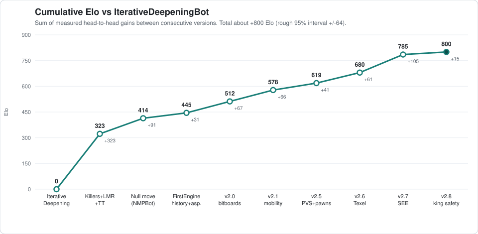

# TurquoiseBOT

[](https://github.com/ranir2026/Lichess/actions/workflows/ci.yml)

A chess engine written from scratch in Java: bitboard move generation, an alpha-beta search with pruning and ordering, a Texel-tuned evaluation, and a self-play testing harness that measures feature updates with confidence intervals and a sequential probability ratio test (SPRT).

When the bot is online, it can be challenged in blitz and rapid time controls on Lichess at: https://lichess.org/@/TurquoiseBOT.

**Author:** Rahul Rani   
**Language:** Java (compiles with `--release 8`)   
**Search:** single-threaded  
**Strength:** about $+920$ Elo over the first version in self-play (a rough chained estimate; see [Results](#results)). v3.2 rates $2296 \pm 12$ on the CCRL Blitz scale, measured against 12 rated engines at 10+0.1 on the author's laptop (see [Absolute rating](#absolute-rating-v32)).




## Contents
1. [Engine at a glance](#engine-at-a-glance)
2. [Versions and naming](#versions-and-naming)
3. [Getting started](#getting-started)
4. [Continuous integration](#continuous-integration)
5. [Testing methodology](#testing-methodology)
6. [Results](#results)
   - [Absolute rating (v3.2)](#absolute-rating-v32)
7. [Version details](#version-details)
8. [Testing history and selection effects (v2.8)](#testing-history-and-selection-effects-v28)
9. [Testing history and selection effects (v2.9)](#testing-history-and-selection-effects-v29)
10. [Testing history and selection effects (v3.0)](#testing-history-and-selection-effects-v30)
11. [Testing history and selection effects (v3.1)](#testing-history-and-selection-effects-v31)
12. [Known limitations](#known-limitations)
13. [Glossary and references](#glossary-and-references)
14. [License](#license)

---

## Engine at a glance

| Area | What is implemented |
|---|---|
| Board and move generation | Bitboard board representation, precomputed attack tables, legal move generation, incremental Zobrist hashing, threefold-repetition and fifty-move detection |
| Search | Iterative deepening, alpha-beta pruning, principal variation search (PVS), check extension, quiescence search (captures, and every evasion when in check), transposition table, null-move pruning, reverse futility pruning, late move reductions (LMR), aspiration windows, static-exchange evaluation (SEE) |
| Move ordering | Hash move, killer moves, history heuristic, counter-move heuristic, SEE |
| Evaluation | Tapered (midgame/endgame) piece-square tables including a separate king endgame table, tapered mobility, isolated pawns, passed pawns with king-proximity scaling, king safety (pawn shield, open files, king-zone attackers, attacker-material scaling). Constants are Texel-tuned |
| Testing and tooling | `PerftTest`, `EvalSymmetryTest`, `KingSafetyTest`, `RfpEquivalenceTest`, `QsEvasionTest`, `CheckExtensionTest`, `TimeCapTest`, `BenchTest`, `Bench` (fixed-depth node-count signature), `SpeedBench`, `SuiteRunner` (self-play A/B harness), `TexelTuner` (parameter tuner), a Swing GUI (`App`) |

## Versions and naming

`TurquoiseBot.java` is the project's single development line and where the next version is built. Each benchmarked milestone is frozen as a named class; the current engine is v3.2 and matches `TimeCapBot`. Frozen versions used by tests remain in the source tree, and earlier milestones can be restored from their git tags. Versions 2.0 onward report their version through `getVersion()`.

| Version | Class | Date | Main Updates |
|---|---|---|---|
| (none) | IterativeDeepeningBot | 2026-04-16 | Iterative deepening + alpha-beta |
| (none) | KillersAndLMRBot | 2026-04-18 | Transposition table, killers, LMR, tapered PST |
| (none) | NMPBot | 2026-04-28 | Null-move pruning, en passant and mate-score fixes |
| (none) | FirstEngine | 2026-05-08 | History/counter-move heuristics, aspiration windows |
| 2.0 | SecondEngine | 2026-06-21 | Board representation rewrite -- use bitboards |
| 2.1 | MobilityBot | 2026-06-23 | Tapered mobility bonuses |
| 2.5 | PVSBot | 2026-07-28 | PVS, isolated and passed pawns |
| 2.6 | TexelBot | 2026-07-29 | Texel-tuned evaluation constants |
| 2.7 | SEEBot | 2026-08-01 | Static-exchange evaluation |
| 2.8 | KingSafetyBot | 2026-10-24 | King-safety evaluation |
| 2.9 | ReverseFutilityBot | 2026-11-08 | Reverse futility pruning |
| 3.0 | QuiescenceEvasionBot | 2026-11-09 | Quiescence search of every evasion when in check |
| 3.1 | CheckExtensionBot | 2026-11-09 | Check extension: a move that gives check is searched one ply deeper |
| 3.2 | TimeCapBot | 2026-11-13 | Time management: the planned think time is capped at the time left |

The array-based engines before 2.0 were removed from the source tree and are available in git history.

## Getting started

Requires a JDK (8 or newer). Run the following commands from the repository root.

### 1. Compile

```bash
javac --release 8 -d bin src/*.java
cp src/precomputed_attacks.bin bin/        # Windows: copy src\precomputed_attacks.bin bin\
```

### 2. Run correctness tests

Each test exits non-zero if it fails. `PerftTest` checks 35 reference node counts.

- Perft counts and board/hash integrity: `java -cp bin PerftTest`
- Evaluation symmetry:  `java -cp bin EvalSymmetryTest`
- King safety: `java -cp bin KingSafetyTest`
- Reverse futility pruning equivalence with KingSafetyBot: `java -cp bin RfpEquivalenceTest`
- Quiescence evasion equivalence with ReverseFutilityBot: `java -cp bin QsEvasionTest`
- Check extension equivalence with QuiescenceEvasionBot: `java -cp bin CheckExtensionTest`
- Time-cap behavior and CheckExtensionBot equivalence: `java -cp bin TimeCapTest`

### 3. Check benchmark signatures

`BenchTest` verifies that frozen engines' signatures have not changed:

```bash
java -cp bin BenchTest
```

To print the fixed-depth signature for each engine:

```bash
java -cp bin Bench
```

### 4. Measure speed (optional)

This reports nodes per second on 20 fixed positions:

```bash
java -cp bin SpeedBench 1000 3 SEEBot KingSafetyBot
```

### 5. Run a self-play match (optional)

This example runs 500 pairs at a 3500 ms time setting. By default, it compares SEEBot with KingSafetyBot:

```bash
java -cp bin -Dsuite.pairs=500 -Dsuite.moveTimeMs=3500 SuiteRunner
```

SuiteRunner writes `suite_results.csv` (one row per game) and `suite_log.csv` (one row per move) to the working directory. Set engine classes with `-Dsuite.engineA=<Class>` and `-Dsuite.engineB=<Class>`.

Other options:
- `-Dsuite.bookSeed=N` selects a different opening book.
- `-Dsuite.failOnError=true` exits non-zero on an illegal move, error or timeout.
- `-Drfp.margin=N` and `-Drfp.maxDepth=N` configure reverse futility pruning; `-Drfp.margin=100000` disables it.
- `-Dqs.evasions=false`, `-Dcheck.extension=false` and `-Dtime.cap=false` disable those TurquoiseBot features.
- `-Dtime.overheadMs=N` sets the time-cap reserve (default 50 ms).

### 6. Tune evaluation (optional)

Requires a dataset of `FEN result` lines; the default `positions.txt` is not included. See `TexelTuner.java` for options.

```bash
java -cp bin TexelTuner --data positions.txt --ks-only --params-out tuned.txt
```

### 7. Launch the GUI (optional)

Run from the repository root so the GUI can load `lib/pieces.png`:

```bash
java -cp bin App
```

**Playing on Lichess.** The engine speaks UCI through a front end that runs under [lichess-bot](https://github.com/lichess-bot-devs/lichess-bot). The UCI front end and the lichess-bot configuration, which hold an API token, are local only and not part of this repository.

## Continuous integration

GitHub Actions runs on every push and pull request:

- **Correctness:** compiles with `--release 8` and runs seven tests.
- **Determinism:** `BenchTest` pins frozen-engine signatures; the dev engine's signature is reported. Shared-code changes that alter a frozen signature fail the check.
- **Smoke match:** runs four pairs of TimeCapBot vs TurquoiseBot at `moveTimeMs=860` and fails on illegal moves, errors or timeouts.

CI checks correctness and determinism, not playing strength. Strength results come from the [SuiteRunner](#results) matches.

## Testing methodology

Version-to-version results use `SuiteRunner`, where engine B (the candidate) plays engine A (the baseline) in-process.

### Games and openings

- The standard book contains 200 random quiet openings of 8 plies, deduplicated by position hash and generated with seed `20260726`. `-Dsuite.bookSeed=N` selects another seed. From v2.9 onward, tuning uses a separate book; confirmation runs use the standard book.
- Each opening is played twice with colors reversed. A 500-pair match is 1000 games; 100 openings are used three times and 100 twice, so samples are not fully independent (see [Known limitations](#known-limitations)).
- Games run one at a time, with fresh engine instances and empty transposition tables.

### Time control and game endings

- `MOVE_TIME_MS` is passed as time remaining; think time is about $\frac{M}{40} - 10\,\mathrm{ms}$, where $M$ is `MOVE_TIME_MS`. The 3500 default is about 80 ms per move (measured ~79 ms); 860 is about 12 ms.
- Games end by checkmate, stalemate, threefold repetition or the fifty-move rule. A 400-half-move or 4-minute limit is a draw; an illegal move loses. There is no adjudication.

### Statistics

- Score: $S = \frac{W + D/2}{N}$; Elo: $E = 400\log_{10}\left(\frac{S}{1-S}\right)$.
- From v2.5 onward, 95% Elo intervals use the variance of per-pair scores (0 to 2). Legacy results use per-game trinomial variance because they have no paired games.
- LOS (likelihood of superiority) ignores draws: $\operatorname{LOS} = \Phi\left(\frac{W-L}{\sqrt{W+L}}\right)$.
- SPRT uses a pentanomial GSPRT on pair scores: $H_0\colon E\le 0$, $H_1\colon E\ge 10$, $\alpha=\beta=0.05$, with LLR bounds $\pm 2.944$. The full sample is always played (`SPRT_STOP_EARLY = false`), so the final LLR is reported. A first-crossing verdict is optimistic because bounds are checked after every pair.

**Hardware:** Intel Core Ultra 7 256V laptop.

**Legacy results:** Before the book and color-reversed pairs were added on 2026-07-27, every game started from the initial position and results were a plain win/loss tally. Results through v2.1 use this older harness and are labeled "legacy." Repeated start positions make their intervals likely too narrow; read the Elo values as rough estimates. The legacy time control was not recorded.

## Results

Each row compares a candidate (B) with its previous baseline (A). "Pairs" denotes the opening-book harness; "legacy" denotes the single-start-position harness.

| B vs A | Harness | W / L / D | Games | Score | Elo (95% CI) | LOS | SPRT |
|---|---|---|---|---|---|---|---|
| KillersAndLMRBot vs IterativeDeepeningBot | legacy | 256 / 18 / 52 | 326 | 86.5% (282/326) | $+322.7 \pm 45.4$ | 100.0% | n/a |
| NMPBot vs KillersAndLMRBot | legacy | 534 / 278 / 188 | 1000 | 62.8% | $+91.0 \pm 19.9$ | 100.0% | n/a |
| FirstEngine vs KillersAndLMRBot | legacy | 564 / 238 / 198 | 1000 | 66.3% | $+117.6 \pm 20.1$ | 100.0% | n/a |
| FirstEngine vs NMPBot | legacy | 440 / 350 / 210 | 1000 | 54.5% | $+31.4 \pm 19.2$ | 99.9% | n/a |
| SecondEngine (v2.0) vs FirstEngine | legacy | 391 / 201 / 408 | 1000 | 59.5% | $+66.8 \pm 16.7$ | 100.0% | n/a |
| MobilityBot (v2.1) vs SecondEngine (v2.0) | legacy | 276 / 88 / 636 | 1000 | 59.4% | $+66.1 \pm 12.8$ | 100.0% | n/a |
| PVSBot (v2.5) vs MobilityBot (v2.1) | pairs | 312 / 195 / 493 | 1000 | 55.9% (558.5/1000) | $+40.8 \pm 14.5$ | 100.0% | LLR +6.61, H1 accepted |
| TexelBot (v2.6) vs PVSBot (v2.5) | pairs | 347 / 173 / 480 | 1000 | 58.7% (587/1000) | $+61.1 \pm 14.5$ | 100.0% | LLR +10.72, H1 accepted |
| SEEBot (v2.7) vs TexelBot (v2.6) | pairs | 436 / 142 / 422 | 1000 | 64.7% (647/1000) | $+105.3 \pm 15.4$ | 100.0% | LLR not recorded |
| KingSafetyBot (v2.8) vs SEEBot (v2.7), 80 ms/move | pairs | 259 / 216 / 525 | 1000 | 52.15% (521.5/1000) | $+14.9 \pm 13.5$ | 97.6% | LLR +2.12, inconclusive |
| KingSafetyBot (v2.8) vs SEEBot (v2.7), 12 ms/move | pairs | 297 / 231 / 472 | 1000 | 53.3% (533/1000) | $+23.0 \pm 14.3$ | 99.8% | LLR +3.41, H1 bound crossed |
| ReverseFutilityBot (v2.9) vs KingSafetyBot (v2.8), 80 ms/move | pairs | 356 / 143 / 501 | 1000 | 60.65% (606.5/1000) | $+75.2 \pm 14.1$ | 100.0% | LLR +14.77, H1 bound crossed |
| ReverseFutilityBot (v2.9) vs KingSafetyBot (v2.8), 12 ms/move | pairs | 341 / 180 / 479 | 1000 | 58.05% (580.5/1000) | $+56.4 \pm 13.4$ | 100.0% | LLR +11.53, H1 bound crossed |
| QuiescenceEvasionBot (v3.0) vs ReverseFutilityBot (v2.9), 80 ms/move | pairs | 287 / 202 / 511 | 1000 | 54.25% (542.5/1000) | $+29.6 \pm 13.6$ | 100.0% | LLR +5.22, H1 bound crossed |
| QuiescenceEvasionBot (v3.0) vs ReverseFutilityBot (v2.9), 12 ms/move | pairs | 273 / 228 / 499 | 1000 | 52.25% (522.5/1000) | $+15.6 \pm 13.9$ | 97.8% | LLR +2.14, inconclusive |
| CheckExtensionBot (v3.1) vs QuiescenceEvasionBot (v3.0), 80 ms/move | pairs | 246 / 203 / 551 | 1000 | 52.15% (521.5/1000) | $+14.9 \pm 13.4$ | 97.9% | LLR +2.15, inconclusive |
| CheckExtensionBot (v3.1) vs QuiescenceEvasionBot (v3.0), 12 ms/move | pairs | 260 / 214 / 526 | 1000 | 52.3% (523/1000) | $+16.0 \pm 13.7$ | 98.3% | LLR +2.27, inconclusive |

Run conditions and deviations are documented in the testing-history sections below.

v3.2 has no self-play row: it changes only time management, leaving the search and bench signature unchanged. SuiteRunner's constant clock and zero increment never trigger the cap; v3.2 was rated separately against external engines (see [Absolute rating](#absolute-rating-v32)).

### Absolute rating (v3.2)

TurquoiseBOT v3.2 (TimeCapBot) played a 12-engine gauntlet with fastchess; Ordo anchored each opponent at its CCRL Blitz rating.

**Result: $2296.3 \pm 12.4$ on the CCRL Blitz scale** (95% range about $[2284, 2309]$), from 2016 games: 518 W / 784 D / 714 L, 45.1%.

**Setup**
- **Match:** 168 games per opponent (84 color-reversed rounds), 10+0.1, four games concurrently, `8moves_v3`, seed `20261113`, Hash=16 where supported, Threads=1, and `timemargin=100` for every engine. The run lasted from 14:42 to 18:24 on 2026-11-13.
- **Opponents (CCRL Blitz rating):** FrankyGo 2014, KhepriChess 2144, GopherCheck 2147, Shuffle 2165, Rusty Rival 2218, Bumblebee 2382, SOFCheck 2384, MinimalChess 2439, Cosette 2442, Wasabi 2545, Tantabus 2554, Blunder 2662. Tinman (XBoard-only) and FKTB, Emerald, Loki and Soomi (blocked by Windows Application Control) were excluded.
- **Adapters and aborted attempts:** FrankyGo and MinimalChess send uppercase promotions, so a pass-through adapter lowercased their `bestmove` lines. Earlier runs were discarded after promotion errors, an opponent flagging by 11 ms, or memory exhaustion with Hash=256.
- **Scale:** CCRL Blitz uses 2'+1" on an i7-4770K. This gauntlet used 10+0.1 on an Intel Core Ultra 7 256V laptop; the result is not an official CCRL rating.

| Per opponent | W / D / L | Score |
|---|---|---|
| FrankyGo (2014) | 95 / 64 / 9 | 75.6% |
| KhepriChess (2144) | 81 / 72 / 15 | 69.6% |
| GopherCheck (2147) | 69 / 74 / 25 | 63.1% |
| Shuffle (2165) | 68 / 84 / 16 | 65.5% |
| Rusty Rival (2218) | 64 / 65 / 39 | 57.4% |
| Bumblebee (2382) | 33 / 78 / 57 | 42.9% |
| SOFCheck (2384) | 22 / 80 / 66 | 36.9% |
| MinimalChess (2439) | 19 / 52 / 97 | 26.8% |
| Cosette (2442) | 24 / 55 / 89 | 30.7% |
| Wasabi (2545) | 14 / 69 / 85 | 28.9% |
| Tantabus (2554) | 17 / 56 / 95 | 26.8% |
| Blunder (2662) | 12 / 35 / 121 | 17.6% |

**Power and standby disturbances:** System and power logs show:
- The laptop switched to battery at 15:23:47. Of 2016 games, 415 were on AC, 1597 on battery, and 4 spanned the change. Opponents' reported depth fell by 1–2.2 plies on battery.
- Lid-closed Modern Standby (18:00:32–18:18:26) froze four games; all ended in time forfeits charged to the opponent, giving TurquoiseBOT four free wins. Three idle standbys did not stop games.
- The keep-awake script stopped around 15:28 and did not prevent the later standbys.

Subsets were defined from the logs before scoring:

| Games | Count | W / D / L | Rating (95%) |
|---|---|---|---|
| All | 2016 | 518 / 784 / 714 | $2296.3 \pm 12.4$ |
| Without the 4 games frozen by the lid standby | 2012 | 514 / 784 / 714 | $2295.1 \pm 12.6$ |
| Without any game that overlapped a standby | 1881 | 479 / 735 / 667 | $2295.8 \pm 12.5$ |
| On AC only | 415 | 104 / 179 / 132 | $2305.0 \pm 28.8$ |

The owner accepted this run as the v3.2 rating rather than rerunning it on AC.

**Interpreting the rating:** Scores rise with opponent strength (about $2210$ against the weakest and $2393$ against the strongest), indicating a compressed scale that depends on the opponent mix. The mean anchor is $2341$. The $\pm 12.4$ interval covers game-sampling error only; it excludes anchor-rating uncertainty (about $\pm 11$ to $\pm 17$ per engine), hardware and time-control differences.

**Cumulative gain.** Summing the consecutive gains through v3.1 at 80 ms/move gives about **$+920 \pm 68$ Elo** over IterativeDeepeningBot. The interval adds individual intervals in quadrature; it assumes Elo is additive and mixes the two harness generations, so it is only a rough estimate. As a check, FirstEngine's direct gain over KillersAndLMRBot is $+117.6$; chaining NMP ($+91.0$) and FirstEngine over NMP ($+31.4$) gives $+122.4$, within the intervals. `docs/make_elo_chart.py` regenerates the chart.

## Version details

### IterativeDeepeningBot (2026-04-16)
- Iterative deepening
- Alpha-beta pruning

### KillersAndLMRBot (2026-04-18)
- King endgame piece-square tables
- Tapered evaluation for piece-square tables
- Transposition tables
- Killer-move tracking
- Late move reductions (LMR)

### NMPBot (2026-04-28)
- Null-move pruning
- Fixed en passant move generation
- Fixed mate-score handling

### FirstEngine (2026-05-08)
- History heuristic
- Counter-move heuristic
- Aspiration windows
- Improved move ordering

### SecondEngine, v2.0 (2026-06-21): switch to bitboards
- Replaced the board representation with bitboards; retained FirstEngine's search and evaluation, with adjusted move-ordering weights and a refactored iterative-deepening loop.

Earlier versions of this README listed depth, node-count and speed tables for this change. Those numbers contained a bug and have been withdrawn. The head-to-head result in the table above is not affected.

### MobilityBot, v2.1 (2026-06-23)
- Mobility bonuses for bishop, rook, knight and queen
- Tapered mobility bonuses

### PVSBot, v2.5 (2026-07-28)
- Isolated-pawn penalty
- Passed-pawn evaluation (replaces the doubled-pawn penalty), with king-proximity scaling
- Principal variation search (PVS)

### TexelBot, v2.6 (2026-07-29)
- Texel-tuned evaluation constants

### SEEBot, v2.7 (2026-08-01)
- Static-exchange evaluation

### KingSafetyBot, v2.8 (2026-10-24)
- Added king-safety evaluation: pawn shield, open and half-open files, weighted king-zone attackers, and a penalty scaled by the opponent's attacking material. Search and other evaluation terms are unchanged from SEEBot v2.7.
- Texel-tuned the 15 new constants on 1.43M Zurichess quiet-labeled positions (80/20 train/validation split). A pawn-storm term remains, tuned to 0.
- `KingSafetyTest` checks that setting all king-safety constants to 0 restores SEEBot's evaluation and search. `PerftTest`, `EvalSymmetryTest` and `SpeedBench` were also added.
- **Game breakdown** (full match statistics in [Results](#results)): middlegame mates, 42 vs 18 at 80 ms/move and 73 vs 28 at 12 ms/move; wins under 60 plies, 47 vs 15 and 61 vs 15; endgame mates, 217 vs 198 and 224 vs 203. Every decisive game ended in checkmate; there were no illegal moves, crashes, time forfeits or move-limit games.
- **Speed:** -3.5% nodes/s on `SpeedBench` (20 positions, 1 s/move); -0.8% at 80 ms/move and -2.7% at 12 ms/move in suite games.

### ReverseFutilityBot, v2.9 (2026-11-08)
- Added reverse futility pruning (static null-move pruning) at non-root, null-window nodes outside check, up to 6 plies from the horizon. It returns beta when $\text{staticEval} - 90 \times \text{depth} \ge \beta$, but is skipped when $|\beta| \ge 50{,}000$ to avoid pruning mate scores.
- Evaluation is shared with null-move pruning; other behavior is unchanged from KingSafetyBot v2.8. Margin 90 was selected from 70, 90 and 110 on a separate book (see [Testing history (v2.9)](#testing-history-and-selection-effects-v29)).
- `RfpEquivalenceTest` checks equivalence with RFP off. With it on, the depth-7 benchmark trees shrink from 1,046,258 to 712,648 nodes (-32%).
- **Speed:** -2.5% nodes/s on `SpeedBench` (20 positions, 100 ms/move, 3 repetitions); -0.2% at 80 ms/move and -1.4% at 12 ms/move in suite games. Average depth rose from 10.80 to 11.42 on `SpeedBench`.

### QuiescenceEvasionBot, v3.0 (2026-11-09)
- Quiescence search now searches every legal evasion when in check, returning mate if none exist. Outside check, it still stands pat and searches non-losing captures; quiescence mates score -100000.
- Other behavior matches ReverseFutilityBot v2.9 (RFP margin 90, maximum depth 6). `QsEvasionTest` checks equivalence with evasions off; with them on, 19 of 20 benchmark trees change and depth-7 nodes rise from 712,648 to 884,887 (+24%).
- At equal time, both versions reach similar depth: 10.17 vs 10.21 plies at 80 ms/move and 7.69 vs 7.75 at 12 ms/move.
- **Speed:** +1.3% nodes/s on `SpeedBench` (20 positions, 100 ms/move, 3 repetitions; depth 11.55 to 11.30); +3.0% at 80 ms/move and +1.3% at 12 ms/move in suite games.

### CheckExtensionBot, v3.1 (2026-11-09)
- In the main search, a move that gives check keeps the parent's remaining depth, extending the line by one ply. The extension applies to searches and re-searches and is capped at 64 plies from the root.
- Other behavior matches QuiescenceEvasionBot v3.0. `CheckExtensionTest` checks equivalence with the extension off; with it on, 19 of 20 benchmark trees change and depth-7 nodes rise from 884,887 to 1,023,727 (+16%). Equivalence tests disable the extension (and QS evasions where needed) to isolate each feature.
- With the extension, searches complete fewer uniform-depth iterations (9.24 vs 10.08 plies at 80 ms/move; 6.93 vs 7.54 at 12 ms/move), while extending checking lines.
- **Speed:** +2.4% nodes/s on `SpeedBench` (20 positions, 100 ms/move, 3 repetitions; depth 11.13 to 10.93); +6.6% at 80 ms/move and +7.5% at 12 ms/move in suite games.

### TimeCapBot, v3.2 (2026-11-13)
- Fixed time management: planned think time, including the opening allowance, is capped at $\max(1\,\mathrm{ms},\,t_{\text{left}}-50\,\mathrm{ms})$ to prevent flagging. The reserve is configurable with `-Dtime.overheadMs`; `-Dtime.cap=false` disables the cap. This only affects clocks with an increment, not SuiteRunner's constant clock.
- Search is unchanged from v3.1 (bench signature 2246792). `TimeCapTest` covers 136 clock cases: the cap changes 64, never exceeds its limit, and matches v3.1 when disabled or under SuiteRunner's clock. At $t_{\text{left}}=1500\,\mathrm{ms}$ with a $2000\,\mathrm{ms}$ increment, it plans $1450\,\mathrm{ms}$ vs v3.1's $2037\,\mathrm{ms}$; measured search took $1441\,\mathrm{ms}$ vs $2028\,\mathrm{ms}$ for CheckExtensionBot.

## Testing history and selection effects (v2.8)

v2.8 is the third king-safety candidate, so the headline result has to be read with that in mind. The first two used a game-phase taper instead of the attacker-material taper and did not pass. They ran mostly on battery power, where this laptop searches about $2.5\times$ slower, so they are not exactly comparable to the v2.8 runs.

| Candidate | Time/move | W / L / D | Score | Elo (95% CI) |
|---|---|---|---|---|
| C1: phase taper, king-safety-only tuning | 80 ms | 244 / 257 / 499 | 49.35% | $-4.5\,[-18.2, +9.2]$ |
| C1 | 12 ms | 298 / 238 / 464 | 53.0% | $+20.9\,[+6.4, +35.4]$ |
| C2: C1 + full re-tune of all constants | 80 ms | 274 / 252 / 474 | 51.1% | $+7.6\,[-6.3, +21.6]$ |
| C2 | 12 ms | 255 / 267 / 478 | 49.4% | $-4.2\,[-18.1, +9.7]$ |
| **v2.8**: attacker-material taper | 80 ms | 259 / 216 / 525 | 52.15% | $+14.9\,[+1.5, +28.4]$ |
| **v2.8** | 12 ms | 297 / 231 / 472 | 53.3% | $+23.0\,[+8.7, +37.3]$ |

**Interpretation:** Both final 95% Elo intervals exclude zero. Across the six candidate/time-control looks, a rough Bonferroni correction gives one-sided $p$-values of about $0.15$ (80 ms/move) and $0.012$ (12 ms/move). The 80 ms/move SPRT is inconclusive (LLR $+2.12$; $H_1$ bound $+2.944$); it tests a gain of at least 10 Elo, not whether the gain is positive.

**Harness note:** A `SuiteRunner` bug reported "$H_0$ ACCEPTED at pair 2" in the 12 ms/move run when the first two pairs scored alike. It was fixed on 2026-11-07 by withholding LLR calculation until 20 pairs; the final LLR ($+3.41$) and other results were unaffected.

## Testing history and selection effects (v2.9)

The reverse futility pruning margin was tuned on a separate opening book (seed 1 instead of 20260726), so the standard book was used only for the confirmation runs. Two rules were fixed before any run: pick the margin with the best Elo, unless all three 95% intervals overlap, in which case use 90; and call v2.9 confirmed only if both confirmation runs have a 95% interval lower bound above 0 Elo. B is TurquoiseBot with RFP, A is KingSafetyBot v2.8. All runs were on AC power apart from the disturbance described below.

| Run | Book seed | Time/move | Pairs | W / L / D | Score | Elo (95% CI) | LLR |
|---|---|---|---|---|---|---|---|
| Tuning, margin 70 | 1 | 12 ms | 200 | 142 / 82 / 176 | 57.5% | $+52.5\,[+30.6, +74.8]$ | +3.88 |
| Tuning, margin 90 | 1 | 12 ms | 200 | 119 / 78 / 203 | 55.1% | $+35.7\,[+14.0, +57.8]$ | +2.51 |
| Tuning, margin 110 | 1 | 12 ms | 200 | 113 / 87 / 200 | 53.25% | $+22.6\,[+1.4, +44.0]$ | +1.50 |
| **v2.9** confirmation, margin 90 | 20260726 | 12 ms | 500 | 341 / 180 / 479 | 58.05% | $+56.4\,[+43.1, +69.9]$ | +11.53 |
| Confirmation, first attempt (invalid: stopped) | 20260726 | 80 ms | 8 | 6 / 4 / 6 | n/a | n/a | n/a |
| **v2.9** confirmation, margin 90 | 20260726 | 80 ms | 500 | 356 / 143 / 501 | 60.65% | $+75.2\,[+61.2, +89.3]$ | +14.77 |

**Interpretation:** The three tuning intervals overlap, so the preset selection rule chose margin 90 despite margin 70's higher point estimate. The standard-book confirmation runs were not used to select the margin; both have positive 95% lower bounds and final LLRs above +2.944. Tuning and confirmation estimates overlap at margin 90.

The first 80 ms/move attempt stopped after 8 pairs because the computer was low on memory; it was rerun, not stopped for its score.

**80 ms/move disturbance:** After unplugging, the laptop spent about 45 seconds on battery and 6 minutes in Modern Standby. A KingSafetyBot move (game 159) froze for 366 seconds at depth 8; the game ended in a repetition draw. Background load then reduced speed to 1.46–1.67M nodes/s for games 160–189, from 1.95–2.18M for the rest; both engines were affected. Excluding pairs 79–82 gives $+75.0\,[+61.1, +89.3]$, LLR $+14.62$; excluding pairs 79–94 gives $+75.1\,[+60.9, +89.6]$, LLR $+14.11$. Subsets were fixed from power logs and node rates before scoring.

## Testing history and selection effects (v3.0)

The change has no parameter, so there was no tuning run and only one candidate. The decision rule was fixed before either run: v3.0 is confirmed only if both confirmation runs have a 95% interval lower bound above 0 Elo. B is TurquoiseBot with quiescence check evasions, A is ReverseFutilityBot v2.9, on the standard book. Both runs were on AC power throughout, with no sleep, standby or other Windows power events, and no timeouts, move-limit games, crashes or errors.

| Run | Book seed | Time/move | Pairs | W / L / D | Score | Elo (95% CI) | LLR |
|---|---|---|---|---|---|---|---|
| **v3.0** confirmation | 20260726 | 12 ms (measured 14.1 ms) | 500 | 273 / 228 / 499 | 52.25% | $+15.6\,[+1.8, +29.5]$ | +2.14 |
| **v3.0** confirmation | 20260726 | 80 ms | 500 | 287 / 202 / 511 | 54.25% | $+29.6\,[+16.1, +43.2]$ | +5.22 |

**Interpretation:** Both 95% intervals exclude zero. The SPRT tests a gain of at least 10 Elo: it crossed $H_1$ at 80 ms/move (LLR $+5.22$) and was inconclusive at 12 ms/move ($+2.14$ vs $+2.944$). The 12 ms/move run averaged 14.1 ms/move for both engines (v2.9: 12.6 ms); the 80 ms/move run averaged 79.1 ms. The cause of the timing variation is unknown. The 12 ms/move result was known before the second run, but both runs were required and are reported.

## Testing history and selection effects (v3.1)

The change has no parameter, so there was no tuning run and only one candidate. The decision rule was fixed before either run: v3.1 is confirmed only if both confirmation runs have a 95% interval lower bound above 0 Elo. B is TurquoiseBot with the check extension, A is QuiescenceEvasionBot v3.0, on the standard book. Both runs were on AC power throughout, with no sleep, standby or other Windows power events during either run, and no timeouts, move-limit games, crashes or errors. The laptop was in Modern Standby for about one second between the two runs, after the 12 ms/move run's last game and before the 80 ms/move run started.

| Run | Book seed | Time/move | Pairs | W / L / D | Score | Elo (95% CI) | LLR |
|---|---|---|---|---|---|---|---|
| **v3.1** confirmation | 20260726 | 12 ms (measured 13.5 ms) | 500 | 260 / 214 / 526 | 52.3% | $+16.0\,[+2.4, +29.7]$ | +2.27 |
| **v3.1** confirmation | 20260726 | 80 ms | 500 | 246 / 203 / 551 | 52.15% | $+14.9\,[+1.6, +28.3]$ | +2.15 |

**Interpretation:** Both 95% intervals exclude zero; neither SPRT reached a bound (LLR $+2.27$ and $+2.15$ vs $+2.944$). The agreed runs ran back to back, 12 ms/move first. Both engines averaged 13.5 ms/move at that setting; the 80 ms/move run averaged 78.8 ms.

## Known limitations

- **Version-to-version Elo is relative and measured in self-play.** Self-play gains tend to overstate gains against other opponents. The only absolute figure is the v3.2 gauntlet ($2296 \pm 12$ on the CCRL Blitz scale), which was run partly on battery and has the caveats listed under [Absolute rating](#absolute-rating-v32).
- **Legacy results (up to v2.1) used a weaker harness** (single start position, no pairing, time control not recorded). See [Testing methodology](#testing-methodology).
- **Repeated openings.** 500 pairs use 200 openings, so games are not fully independent and the true uncertainty is somewhat larger than the reported intervals.
- **Move times are very short** (about 80 ms and 12 ms per move). Results may not carry over to longer time controls.
- **The move generator was fixed after the v2.8 results were recorded.** On 2026-11-07 a bug in en passant check evasion was fixed: when a pawn that had just advanced two squares gave check, the en passant capture of that pawn was wrongly rejected as illegal. `PerftTest` now matches all 35 reference node counts (and depth 6 for the two positions that have one), where it previously missed 81 of 674,624 nodes in one position. All results up to v2.8 were recorded with the earlier generator, which the version tags preserve, and were not re-run. The v2.9, v3.0 and v3.1 results were recorded with the fixed generator. The affected positions are rare in play.
- **Some run conditions were not recorded** for older runs (hardware, power state, and the SPRT LLR for v2.7).

## Glossary and references

- **Elo difference.** Strength difference implied by a match score. $100$ Elo is about a $64\%$ score.
- **Texel tuning.** Fitting evaluation constants by minimising the error between a sigmoid of the evaluation and game results over a set of quiet positions. See [Texel's Tuning Method](https://www.chessprogramming.org/Texel%27s_Tuning_Method). The dataset used is the Zurichess quiet-labeled position set.
- **Perft.** Counting all leaf nodes of the legal-move tree to a fixed depth and comparing with published counts. See [Perft Results](https://www.chessprogramming.org/Perft_Results).
- **SEE.** Static-exchange evaluation of a capture sequence on one square. See [Static Exchange Evaluation](https://www.chessprogramming.org/Static_Exchange_Evaluation).
- **LMR / PVS / NMP.** Late move reductions, principal variation search, null-move pruning. See the [Chess Programming Wiki](https://www.chessprogramming.org/).

## License

MIT. See [LICENSE](LICENSE).
